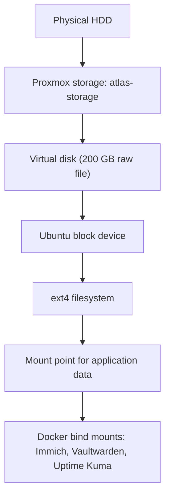

# Storage architecture (current implementation)

Paths and device names are as configured. No addresses are shown on this page.

## Physical drives

| Drive | Size | Used for |
|---|---|---|
| NVMe SSD | about 238 GB | Proxmox OS, plus a thin-provisioned pool for VM disks |
| SATA HDD | about 466 GB | Bulk storage: Docker and application data |

## Proxmox storage definitions

| Storage name | Type | Lives on | Allowed content |
|---|---|---|---|
| local | directory | Proxmox OS filesystem on the NVMe | ISOs, templates, backups |
| local-lvm | LVM-thin | Rest of the NVMe | VM disks |
| atlas-storage | directory (ext4) | The whole HDD | VM disk images |

## VM 100 disks

| Disk | Size | Stored on | Appears in the VM as |
|---|---|---|---|
| OS disk | 64 GB | local-lvm (NVMe) | system disk |
| Data disk | 200 GB | atlas-storage (HDD), as a raw image file | second disk, ext4, mounted for application data |

The data disk is a sparse file: it is presented as 200 GB, but only written data uses space on the HDD.

## Storage layering:

## Design notes and limitations

- Application data lives on the HDD, separate from the NVMe that holds the Proxmox OS and VM system disk.
- The only storage that currently accepts backups is `local`, which shares a filesystem with the Proxmox OS. It is too small and too risky for large backups, so it is not used for them.
- `atlas-storage` is not yet configured to accept backups. Setting up a backup target is planned (not yet implemented).
- Both drives are in one machine. A host failure affects both.
